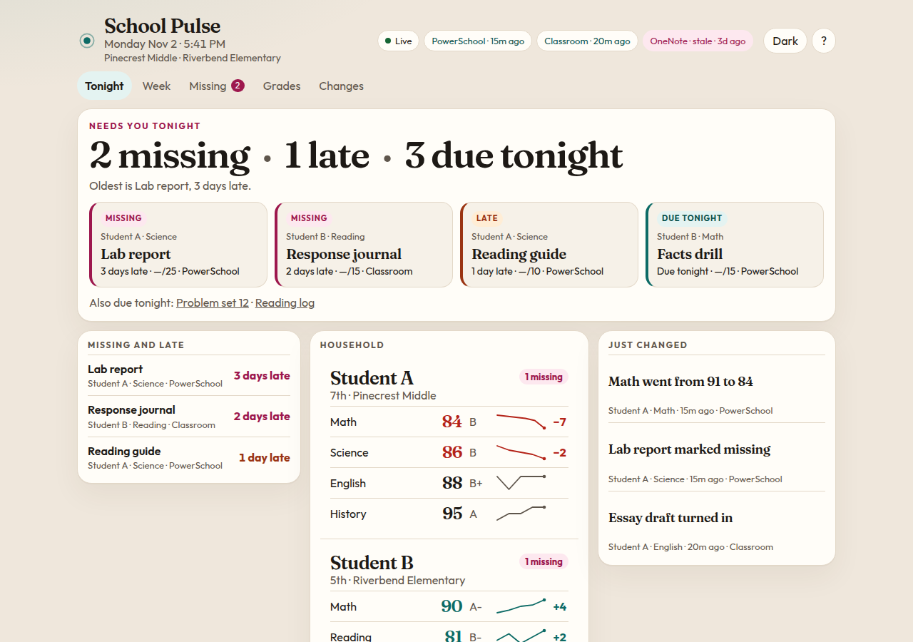
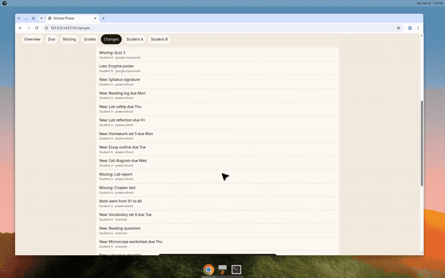

# School Pulse

A local, read-only dashboard for a household's grades, assignments, and homework. Open it at the end of the day and the first screen answers what needs attention tonight: missing and late work, what's due before bed, grade trends, and a short feed of what changed.

Synthetic students only. Real records stay on your machine.

## Quick start

```bash
npm install
npm test
npm run demo
```

Open the URL it prints (http://127.0.0.1:4173). You should see Student A at Pinecrest Middle and Student B at Riverbend Elementary, with work from PowerSchool, Classroom, and OneNote. "Tonight" and "this week" use America/New_York unless you set `SCHOOL_PULSE_TZ`.



In a second terminal, drop a live update into the inbox:

```bash
cp fixtures/demo/live-update.json data/inbox/powerschool/live-update.json
```

Math falls from 84 to 76, and Field trip form shows up as missing. Both animate in.



`H W M G C` switch views. `J` / `K` move. `Enter` opens a student. `T` toggles dark and light. `?` lists the rest.

Import a single file without starting the watcher:

```bash
npm run ingest -- fixtures/generic/snapshot.json
```

Run that again. The second time prints `No changes. Already imported.`

## What you see

The household view is the product:

- **Tonight** is the headline. Counts of missing, late, and due-tonight work, then the most urgent cards.
- **Missing and late** sits directly underneath, with how late each item is.
- **Grades** show the current percent, the move since the previous snapshot, and a sparkline.
- **Just changed** is plain language: "Math went from 91 to 84", "New: Field trip form due tonight".
- **Freshness** is a badge per source. A source with no successful import for 48 hours is marked stale. 12 hours is aging. When a saved refresh token is rejected, that badge reads **re-auth needed**.

Other views: this week, missing and late, grades, the full change feed, and one page per student.

The page updates over server-sent events when an inbox file or `POST /api/ingest` lands something new. New rows slide in and the headline recounts.

## Adapters

Put exports in `data/inbox/<source>/`. The folder name picks the parser. JSON, HTML, and CSV are watched. The same `source` + `sourceId` updates the existing row. Grade history in one file draws the sparkline without a sentence for every old point. A later file with a new percent writes one change.

Portal HTML and the Classroom / Graph list payloads are parsed to match the public page and API shapes. The field notes, read-only scopes, and the loopback sign-in are in [docs/ADAPTERS.md](docs/ADAPTERS.md).

```bash
export SCHOOL_PULSE_GOOGLE_CLIENT_ID="your-desktop-client"
school-pulse auth classroom --student stu-a
school-pulse auth classroom --student stu-b
export SCHOOL_PULSE_GRAPH_CLIENT_ID="your-public-client"
school-pulse auth onenote --student stu-a
school-pulse auth status
school-pulse sync
```

Sign in once per student. Each account is stored in the same token file, keyed by the signed-in email or id, and mapped to the `--student` id you pass. A second sign-in leaves the first account in place. `school-pulse sync` reads every saved account. Access tokens are refreshed before they expire and again if Classroom or Graph answers 401. The refresh token stays in `data/tokens/`. If a refresh is rejected, `school-pulse auth status` and the dashboard badge both say `re-auth needed` for that student. PowerSchool stays a saved snapshot.

### Google Cloud desktop OAuth client

Do this once. The same client id signs in every student. Use a project you control. The client id is not a secret you commit; it still stays out of this repo.

1. Open [Google Cloud Console](https://console.cloud.google.com/) and create a project named `School Pulse`.
2. Enable the Classroom API. Go to **APIs & Services → Library**, search for **Google Classroom API**, and click **Enable**. Direct link: `https://console.cloud.google.com/apis/library/classroom.googleapis.com`.
3. Open the consent screen. The current console calls this **Google Auth Platform → Branding**. The older label is **APIs & Services → OAuth consent screen**.
   - App name: `School Pulse`
   - User support email: your own email
   - Audience: **External**
   - Leave the publishing status at **Testing**. A household does not need to submit the app for verification.
4. Add scopes under **Google Auth Platform → Data Access** (older label: **Scopes**). Add only these:
   - `openid`
   - `email`
   - `https://www.googleapis.com/auth/classroom.courses.readonly`
   - `https://www.googleapis.com/auth/classroom.coursework.me.readonly`
   - `https://www.googleapis.com/auth/classroom.student-submissions.me.readonly`
   Do not add a `.students` scope or any scope that can turn in or grade work.
5. Add test users under **Google Auth Platform → Audience**. Add each student's Google account. While the app stays in Testing, only those accounts can sign in.
6. Create the client. **Google Auth Platform → Clients → Create client** (older path: **APIs & Services → Credentials → Create credentials → OAuth client ID**).
   - Application type: **Desktop app**
   - Name: `School Pulse`
7. Copy the **Client ID**. It ends in `.apps.googleusercontent.com`. A desktop client also shows a client secret. School Pulse uses PKCE and signs in without it. Leave the secret unset unless the token endpoint asks for one. If you do set `SCHOOL_PULSE_GOOGLE_CLIENT_SECRET`, it is sent only to Google's token endpoint.
8. Do not add a web redirect URI. A Desktop client may use `http://127.0.0.1` on whatever port is free. School Pulse binds that port when you sign in.
9. Sign each student in from a browser that is already that student. Sign out of the previous account, or use a private window, so Google does not reuse the first session.

```bash
export SCHOOL_PULSE_GOOGLE_CLIENT_ID="YOUR_CLIENT_ID.apps.googleusercontent.com"
school-pulse auth classroom --student stu-a
school-pulse auth classroom --student stu-b
school-pulse auth status
school-pulse sync
```

Google expires refresh tokens for an app that stays in Testing after 7 days. The next sync then shows `re-auth needed` for that student. Run `school-pulse auth classroom --student <id>` again. The other students stay in the token file.

The field notes for PowerSchool, Classroom, and OneNote, including the Microsoft app registration, are in [docs/ADAPTERS.md](docs/ADAPTERS.md).

Demo files may contain `{{SP:TODAY}}`, `{{SP:TOMORROW}}`, `{{SP:FRIDAY}}`, `{{SP:PLUS_DAYS:2}}`, `{{SP:MINUS_DAYS:3}}`, `{{SP:MINUS_HOURS:2}}`, and `{{SP:MINUS_MIN:15}}`. Those expand when the file is read so a fixture still means "tonight" next month. Real exports will not have them.

### PowerSchool

Save the parent-portal quick lookup and the class scores page from the browser, or a JSON export shaped like the portal payload (`student` / `students`, `finalGrades`, `assignments` with `sectionId`, score, and `missing` / `late` / `exempt` flags). HTML tables that use the usual Course / Assignment / Score / Codes columns are parsed too.

```bash
npm run ingest -- fixtures/powerschool/scores.html --source powerschool
```

Live fetch is intentionally not required. Many schools only allow a browser sign-in. Drop the saved page in `data/inbox/powerschool/`.

### OneNote

Accepts a Microsoft Graph `onenote/pages` payload whose page `content` is HTML, or an HTML export of a class notebook page. Lines like `Map skills — due Friday, Nov 6` and `Chapter questions (due 11/3/2026)` become assignments. A `student` object (or the notebook display name) says who the page belongs to. Optional `grades` on the same file supply the sparkline, because a class notebook page usually has no course percent.

### Google Classroom

Accepts the official list shapes: `courses`, `courseWork` (`dueDate` / `dueTime`, `maxPoints`, `workType`), and `studentSubmissions` (`state`, `late`, `assignedGrade`), plus `students` and `teachers` profiles. `MATERIAL` and `ANNOUNCEMENT` items are skipped. Archived courses are skipped. A submission that is still `CREATED` after the due time is treated as missing. An optional `grades` array carries course-level history, which those list endpoints do not include.

Use a guardian or student token only on your machine. This repo never ships one. A JSON export is enough.

### Generic

JSON in the core shape, or CSV. This is the path for a script that already normalized some other system.

JSON:

```json
{
  "students": [{ "sourceId": "stu-a", "name": "Student A", "school": "Pinecrest Middle" }],
  "courses": [{ "sourceId": "math", "studentSourceId": "stu-a", "name": "Math" }],
  "assignments": [{
    "sourceId": "a1",
    "studentSourceId": "stu-a",
    "courseSourceId": "math",
    "title": "Problem set 12",
    "due": "2026-11-02T23:59:00.000Z",
    "status": "assigned"
  }],
  "grades": [{ "studentSourceId": "stu-a", "courseSourceId": "math", "percent": 91, "letter": "A-", "asOf": "2026-11-02T16:00:00.000Z" }]
}
```

Status is one of `assigned`, `turned_in`, `graded`, `missing`, `late`, `excused`.

CSV columns: `student`, `student_id`, `school`, `grade_level`, `course`, `course_id`, `teacher`, `period`, `title`, `assignment_id`, `due`, `assigned`, `status`, `points_earned`, `points_possible`, `category`, `url`, `percent`, `letter`, `as_of`.

### Ingest API

Anything on the machine can push a snapshot. `POST /api/ingest?source=powerschool&filename=home.html` with the raw HTML, JSON, or CSV body. Or send `Content-Type: application/json` and `{ "source", "filename", "body" }` when the snapshot is a string inside the envelope. The server is bound to `127.0.0.1`. A repeat of the same rows returns `200` with `"unchanged": true`. A file it cannot parse returns `400`. The full contract, including the live `GET /api/events` stream, is in [docs/ADAPTERS.md](docs/ADAPTERS.md).

## Alerts

Off until you add a rule. Nothing is sent anywhere by default.

```bash
curl -s -X PUT http://127.0.0.1:4173/api/alerts/rules \
  -H 'content-type: application/json' \
  -d '{"rules":[{"type":"grade_below","threshold":80,"enabled":true}]}'
```

Rule types:

- `grade_below` — latest percent is under the threshold
- `missing_above` — a student's missing count is above the threshold
- `grade_drop` — the latest snapshot fell by at least this many points

`PUT /api/alerts/webhook` with `{ "url": "http://127.0.0.1:9000/hook" }` posts `{ "alerts": [...] }` when new alerts are stored. `GET /api/alerts` lists rules, the webhook, and alerts already raised. The same condition does not alert again.

## CLI

```text
school-pulse demo [--port 4173] [--data ./data]
school-pulse serve [--port 4173] [--host 127.0.0.1] [--data ./data]
school-pulse ingest <file> [--source <name>] [--data ./data]
school-pulse auth classroom --student <id>
school-pulse auth onenote --student <id>
school-pulse auth status
school-pulse sync [--data ./data]
```

The data directory defaults to `./data`, or `SCHOOL_PULSE_DATA`. The database is `school-pulse.sqlite` inside it. `SCHOOL_PULSE_TZ` defaults to `America/New_York`.

## Privacy

- The only people in this repository are synthetic: Student A, Student B, Teacher A–F, Pinecrest Middle, Riverbend Elementary. Do not add real names, emails, student IDs, or school domains to code, fixtures, screenshots, or issues.
- Real data belongs in the data directory, which is git-ignored. Set `SCHOOL_PULSE_DATA` if you want that directory outside the checkout.
- The tool is read-only toward schools. It does not submit work, message teachers, or change a source system.
- No credentials belong in the repo. `school-pulse auth` writes access tokens and refresh tokens into the data directory, one account per signed-in student. PowerSchool passwords are never collected. Prefer a browser-saved snapshot when the school only allows an interactive login.
- The server listens on localhost. Alerts and webhooks are off until you turn a rule on.

## Development

Node 22 or newer. `npm test` typechecks the server and the dashboard (`tsc --strict`) and runs the fixture tests. SQLite is the built-in `node:sqlite` module.

Screenshots in `screenshots/` are from the synthetic demo.
